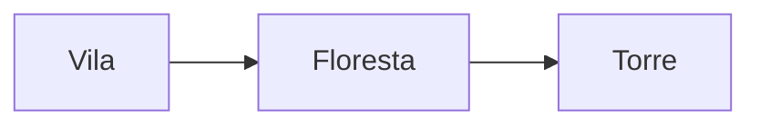

Alguns blocos de código com um nome especial são **desenhados** pelo app: em vez do código, aparece um calendário, um
mapa, uma tabela rolável. O texto do bloco continua na nota (em YAML ou na linguagem do plugin), então o Obsidian o
guarda sem perder nada. Para editar, abra a nota no modo Editar ou Código.

### Calendário do mundo: `runas-calendario`

Fica numa nota da Wiki (Novo artigo › Calendário já cria o bloco pronto). Chaves principais:

```yaml
nome: Calendário de Ordem x Caos
sigla: OC                 # vai depois das datas nas notas: "3999-02-12 OC"
sufixo: C.E.              # depois do ano; sufixo_negativo para anos antes do 0
semana: [Pedra, Raiz, Chama, Vento, Maré, Sombra]
meses:
  - { nome: Gelo, dias: 36, estacao: Inverno }
  - { nome: Dias de Logi, dias: 5, intercalar: true }   # fora da semana
bissexto: { a_cada: 4, mes: Gelo, dias: 1 }
luas:
  - { nome: Selene, ciclo: 28, cheia_em: "0000-01-04" }
eras:
  - { nome: Era dos Caçadores, inicio: 4027 }
feriados:
  - { nome: Festa das Cinzas, data: "07-01" }           # todo ano
hoje: "4031-07-15"        # a data atual da campanha
```

Datas são `ANO-MM-DD`; o ano pode ser 0 ou negativo. Erros no bloco aparecem dizendo o que corrigir. O tópico
**Wiki: calendários e linha do tempo** explica como as notas usam o calendário.

### Mapa: `runas-mapa`

```yaml
imagem: "[[Mapas/Condado de Valdris.png]]"
camadas: [Locais, Perigos, Segredos]
escala: { pixels: 100, distancia: 10, unidade: km }
viagem: { por_dia: 30 }
pinos:
  - { nota: "[[Valdris]]", x: 0.42, y: 0.55, camada: Locais }
  - { rotulo: Ponte quebrada, x: 0.6, y: 0.3, camada: Perigos, segredo: true }
```

`x` e `y` vão de 0 a 1 (fração da largura e da altura). Pinos, zonas, rotas e rótulos também são criados clicando no
mapa (Wiki › Mapas); o app grava no mesmo bloco.

### Tabela rolável: `runas-tabela`

```yaml
nome: Rumores da estrada
resultados:
  - texto: Uma caravana desapareceu.
    peso: 2                  # sai duas vezes mais
  - texto: Um visitante traz novidades.
    tabela: "[[Visitantes]]"  # rola também a tabela desta nota
  - Um texto simples também vale.
```

Na leitura aparece o botão **Rolar tabela** e a lista dos resultados possíveis. Uma tabela pode chamar outra, até
dez em cadeia.

### Idioma: `runas-idioma`

```yaml
nome: Élfico
regras: As vogais são longas; o acento cai na primeira sílaba.
palavras:
  - palavra: aelin
    traducao: lago
    pronuncia: áe-lin
```

Vira um dicionário com busca (até 10 mil palavras).

### Encontro: `runas-encontro`

```yaml
nome: Emboscada na estrada
jogadores: true            # true = todos; ou uma lista de nomes
combatentes:
  - { nome: Goblin, quantidade: 3, pv: 7, ca: 15, iniciativa: 2 }
  - { nome: Hobgoblin, apelido: Capitão, nota: "[[Hobgoblin]]", oculto: true }
  - { nome: Lobo, quantidade: 1d4, aliado: true }
```

`iniciativa` é o modificador somado à rolagem; `quantidade` pode ser uma rolagem; `oculto` não aparece para os
jogadores. O bloco rola a iniciativa para jogo presencial e pode ser mandado para a mesa do VTT.

### Tarefas: `tasks`

Consultas no formato do plugin Tasks, como `not done`, `due before tomorrow`, `path includes Campanhas`,
`group by due`, `sort by priority`, `limit 10`. Veja o tópico **Tarefas**.

### Consultas: `base`, `dataview` e `runas-consulta`

Listas e tabelas que se atualizam sozinhas a partir das propriedades das notas.

````markdown
```dataview
TABLE especie, status FROM "Wikis/Valknut/Personagens" WHERE status = "Vivo" SORT file.name
```
````

- `dataview` e `runas-consulta` aceitam `LIST` e `TABLE` com `FROM`, `WHERE`, `SORT` e `LIMIT` (DataviewJS, TASK e
  CALENDAR não rodam).
- `base` usa o formato das Bases do Obsidian (YAML com `filters`, `formulas` e `views` do tipo `table`, `cards` ou
  `list`); arquivos `.base` abrem como nota. Notas › ⋯ › Nova base cria uma.

### Diagramas: `mermaid`

````markdown

````

Aparece assim:


### Sumário: `table-of-contents`

Um bloco vazio com esse nome (ou `toc`) mostra os títulos da nota com links.

### Colunas automáticas (Livros)

```markdown
::: runas-colunas-2

O texto flui em duas colunas, como nos livros de RPG.

:::
```

De 1 a 4 colunas. Na nota aparece uma moldura discreta; no livro, as colunas de verdade.

### Dados nas notas

`` `dice: 2d6+3` `` vira um botão: clique para rolar. A notação aceita `XdY`, somas e subtrações, `kh3`/`kl1`
(manter os maiores/menores), `!` (dado explosivo), `d%` e `dF` (Fate).
