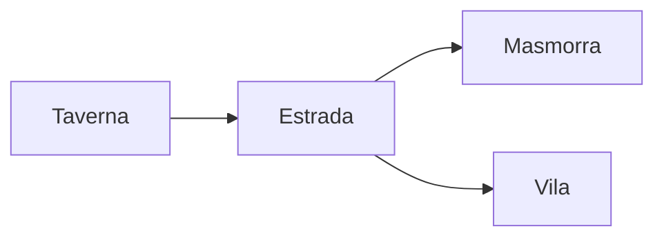

# Formatadores do Runas-Codex

Nota de teste da etapa 3b: tudo aqui precisa aparecer igual no app e no Obsidian (com o snippet
`runas-codex.css` ligado). O que só existe no app está no fim, em “Só no Runas-Codex”.

```table-of-contents
```

## CommonMark

### Títulos
#### Quarto nível
##### Quinto nível
###### Sexto nível

Texto com **negrito**, *itálico*, ***negrito e itálico***, `código inline` e um escape: \*sem itálico\* e \# sem título.
Esta linha termina com quebra forçada  
e continua aqui, na linha de baixo.

> Citação de primeiro nível.
> > Citação aninhada dentro dela.

- Lista não ordenada
  - Subitem
    - Sub-subitem
- Outro item

1. Primeiro
2. Segundo
   1. Dentro do segundo
3. Terceiro

---

[Link com título](https://obsidian.md "Site do Obsidian") e uma imagem do cofre: ![[runa.png|64]]

```ts
// Bloco de código com realce de sintaxe
function rolar(lados: number): number {
  return 1 + Math.floor(Math.random() * lados)
}
```

<p align="center">Parágrafo centralizado em <u>HTML</u>, com <sup>sobrescrito</sup> e <sub>subscrito</sub>.</p>

## GitHub Flavored Markdown

| Esquerda | Centro | Direita |
| :------- | :----: | ------: |
| Espada   |  1d8   |   15 po |
| Escudo   |   —    |   10 po |

~~Tachado~~, um autolink: https://example.com e tarefas:

- [x] Feita
- [ ] Por fazer

Uma nota de rodapé[^1] e uma inline.^[Nota de rodapé escrita no próprio texto.]

[^1]: O texto da nota de rodapé.

## Obsidian

Um ==destaque== e um comentário oculto: %%isto não aparece na leitura%% (só no código-fonte).

Links: [[Caderno]], [[Caderno#Ideias|com título]], [[#GitHub Flavored Markdown]] e #tag/aninhada.
Ano não é tag: #1492.

> [!nota] Callout com título
> Texto do callout com **Markdown** dentro.

> [!aviso]- Callout dobrado (clique para abrir)
> Conteúdo escondido.
> > [!dica] Callout aninhado
> > Dentro do outro.

Matemática inline $e^{i\pi} + 1 = 0$ e em bloco:

$$
\int_0^1 x^2 \, dx = \frac{1}{3}
$$



Parágrafo com bloco nomeado. ^bloco-exemplo

Transclusão de um trecho de outra nota:

![[Caderno#Ideias]]

## Dialeto do Runas-Codex

<span style="color:#8b1e1e; font-size:1.2em; font-family:'Cinzel'">Texto colorido, maior e em Cinzel</span>,
<span class="versalete">versalete</span>, <mark style="background:#9dcbb455">realce colorido</mark> e
<kbd>Ctrl</kbd> + <kbd>K</kbd>.

<p align="right">Alinhado à direita.</p>
<p align="justify">Justificado: um parágrafo um pouco mais longo para mostrar o alinhamento justificado, com as
linhas ocupando a largura inteira da coluna, como num livro impresso.</p>

<span class="capitular">E</span>ra uma vez um reino de cinzas, onde a primeira letra do capítulo ocupa três
linhas, como nos manuais de RPG impressos. A capitular flutua à esquerda do texto.

> [!descritivo]
> A porta range. Um cheiro de mofo e ferro velho sobe da escada que desce para a escuridão.

> [!barra-lateral] Barra lateral
> Uma caixa ao lado do texto, para regras opcionais.

> [!statblock] Lobo das Cinzas
> **CA** 13 · **PV** 11 (2d8+2) · **Desl.** 12 m

> [!colunas]
> Primeira coluna do texto. O conteúdo se divide em duas colunas, como num livro.
> <div class="quebra-coluna"></div>
>
> Segunda coluna, depois da quebra de coluna.

> [!largo]
> Bloco largo: ocupa todas as colunas da página.

<div class="quebra-pagina"></div>

<table class="listrada">
<tr><th colspan="2">Tabela com células mescladas</th></tr>
<tr><td>Nível 1</td><td>Truque</td></tr>
<tr><td>Nível 2</td><td>Magia de 1º círculo</td></tr>
</table>

<figure>

<figcaption>Legenda de imagem (figura numerada)</figcaption>
</figure>

 Imagem flutuando à direita do texto,
que contorna a imagem enquanto houver espaço ao lado dela.

<hr class="ornamento">

<details>
<summary>Seção recolhível</summary>

Conteúdo que aparece ao abrir.
</details>

Rolagem na nota: `dice: 2d6+3`.

## Só no Runas-Codex

O Obsidian mostra estes itens como texto comum:

*[PdM]: Personagem do mestre

Termo da lista de definição
: A definição do termo.

Um PdM com abreviação, emoji por código :espada: :dado: e um parágrafo com classe. {.centro}

::: nota
Contêiner nomeado com `:::`.
:::
