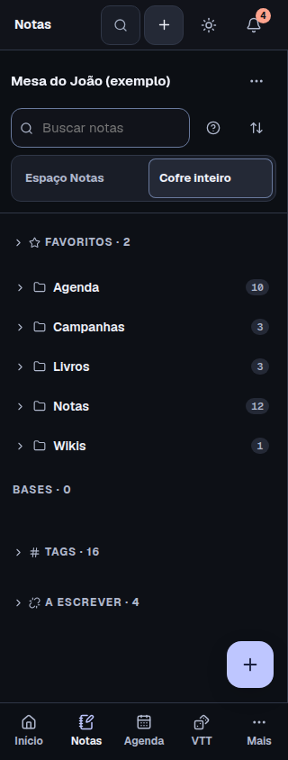

# Contador das pastas de Notas — pedido de 17/11

A bolinha mostrava só as notas diretamente na pasta: Campanhas, Livros e Wikis mostravam 0 mesmo contendo subpastas. Agora soma arquivos diretos e subpastas imediatas, sem somar os descendentes. Inclui anexos, deduplica pastas e usa os mesmos números na dica e no nome acessível. A contagem é calculada uma vez por mudança do índice, em uma passagem pelos caminhos; nenhum arquivo do cofre é regravado. A árvore de notas conserva seu conteúdo e sua navegação.

## Verificação

Quatro testes do núcleo cobrem pastas sem notas próprias, arquivos de tipos diferentes, deduplicação/descendentes, pastas vazias e ocultas. Resultados gerais de tipos, suíte, builds, smokes e CI ficam na descrição do PR.

Cofre de exemplo em memória, perfis novos do Electron offscreen; nenhuma captura do cofre pessoal. Pastas recolhidas para mostrar os contadores das cinco raízes. 320/390/1366 px × claro/escuro, antes e depois: seis pares sem rolagem lateral e mesma ordem dos controles no Tab. No exemplo: Campanhas 0→3, Livros 0→3, Wikis 0→1, Notas 8→12 (8 notas + 1 imagem + 3 pastas). Dados completos em [antes](imagens/contagem-pastas-1.5/antes.json) e [depois](imagens/contagem-pastas-1.5/depois.json).

| Largura/tema | Antes | Depois |
|---|---|---|
| 320 escuro |  |  |
| 390 claro |  |  |
| 1366 claro |  |  |

Limite preservado da plataforma: diretórios vazios anteriores à sessão não são fornecidos por listVault. A contagem usa os caminhos do índice e as pastas vazias criadas no app durante a sessão; descobrir outros diretórios vazios exige uma mudança separada no contrato de listagem. Android físico e leitor de tela físico não verificados.
