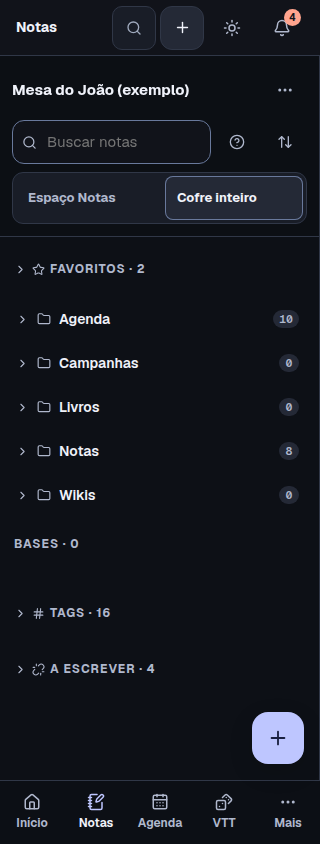
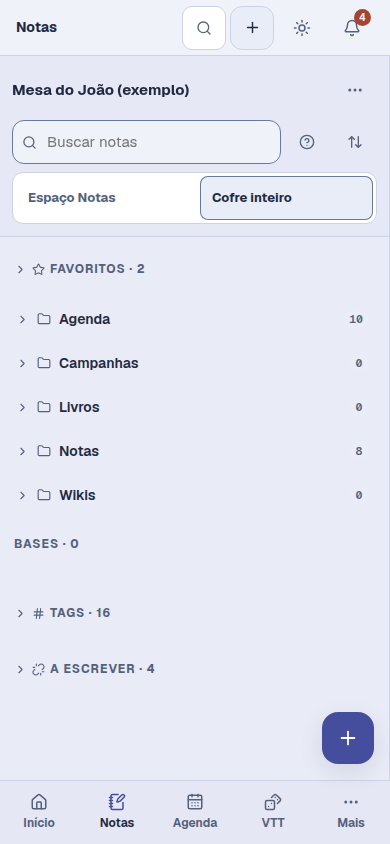
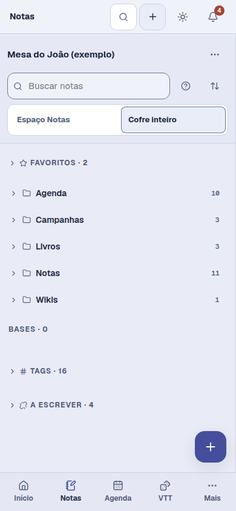
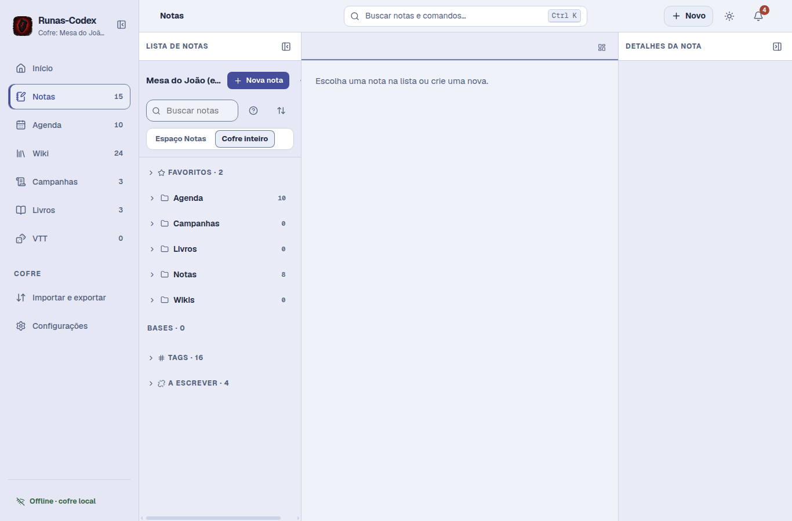
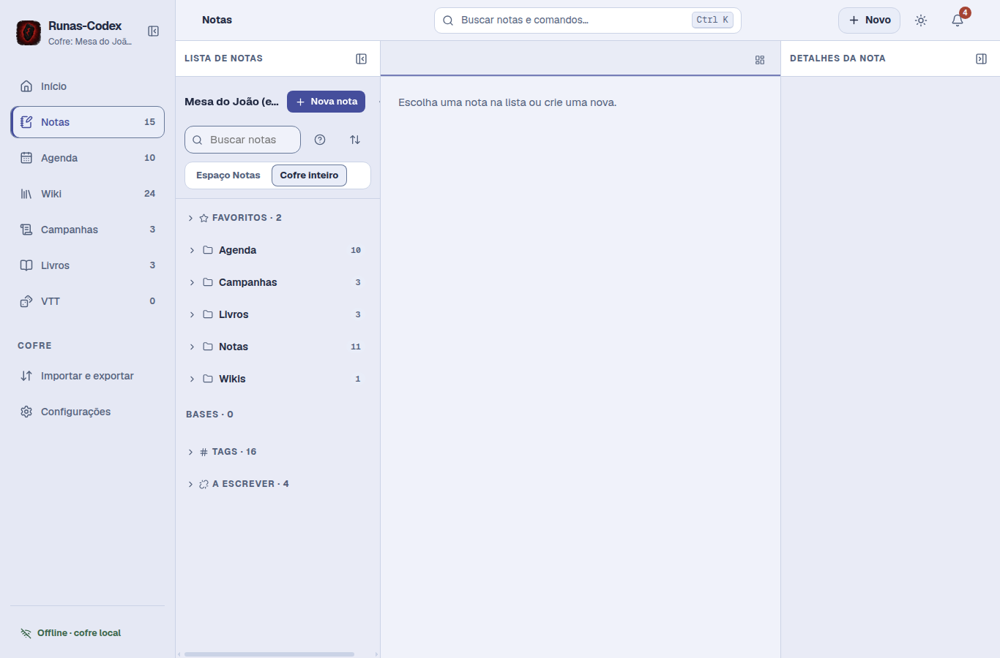

# Contador das pastas de Notas — pedido de 17/11

A bolinha mostrava só as notas diretamente na pasta: Campanhas, Livros e Wikis mostravam 0 mesmo contendo subpastas. Agora soma as notas e as subpastas imediatas, sem somar os descendentes: exatamente o que aparece ao abrir a pasta. Anexos (imagens, PDFs…) não aparecem na árvore de Notas e por isso não entram — a primeira versão os contava, e a pasta Notas do exemplo mostrava 12 com 11 linhas. A dica e o nome acessível dizem os mesmos números. A conta sai da própria árvore desenhada; nenhum arquivo do cofre é regravado.

## Verificação

Três testes do núcleo cobrem pastas sem notas próprias, a soma de notas e subpastas sem descendentes e o texto da dica no singular e no plural. Resultados gerais de tipos, suíte, builds, smokes e CI ficam na descrição do PR.

Cofre de exemplo em memória, perfis novos do Electron offscreen; nenhuma captura do cofre pessoal. Pastas recolhidas para mostrar os contadores das cinco raízes. 320/390/1366 px × claro/escuro, antes e depois: seis pares sem rolagem lateral e mesma ordem dos controles no Tab. No exemplo: Campanhas 0→3, Livros 0→3, Wikis 0→1, Notas 8→11 (8 notas + 3 pastas; a imagem da pasta fica fora, como na lista). Dados completos em [antes](imagens/contagem-pastas-1.5/antes.json) e [depois](imagens/contagem-pastas-1.5/depois.json).

| Largura/tema | Antes | Depois |
|---|---|---|
| 320 escuro |  |  |
| 390 claro |  |  |
| 1366 claro |  |  |

Limite preservado da plataforma: diretórios vazios anteriores à sessão não são fornecidos por listVault, então não aparecem na árvore nem na conta; as pastas vazias criadas no app durante a sessão aparecem e contam. Android físico e leitor de tela físico não verificados.
