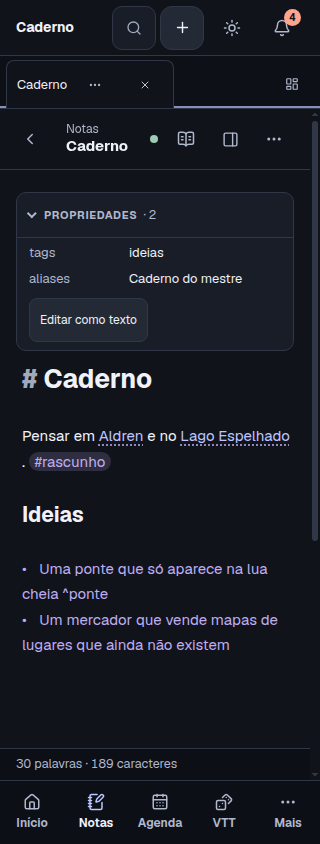
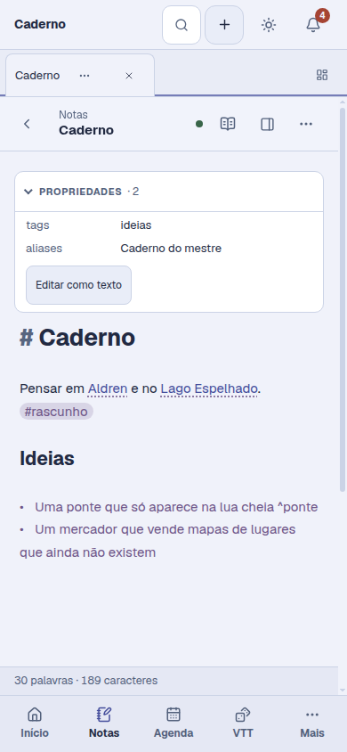
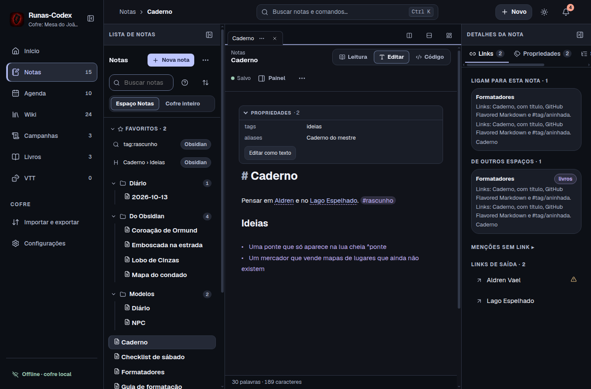
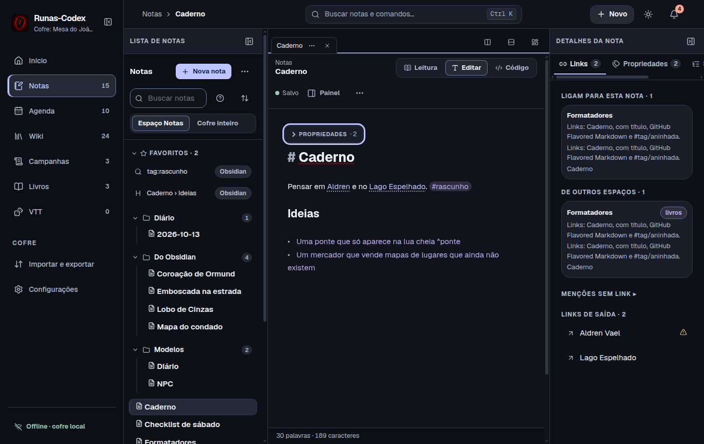

# E/U79 — Propriedades pelo teclado

A barra saiu do contenteditable do CodeMirror para um irmão anterior ao editor. O mesmo estado e a mesma proteção do YAML comandam o cartão; abrir/fechar não muda texto nem seleção. Alt+P alterna e foca a barra. O botão permanece conectado ao DOM durante a atualização, preservando Enter/Space e o foco. Desmontar a extensão remove seu próprio cartão.

O CSS do cartão foi levado do tema interno do CodeMirror para um arquivo com escopo `.source-editor`, porque os controles agora ficam fora dele. Cores, tipografia, medidas e conteúdo foram preservados; o anel de foco passa a 3 px. O leitor Markdown e o dialeto não mudaram. Os dois irmãos repartem a altura mínima anterior do editor, sem acrescentar espaço vazio ao fim.

## Conferência visual

Cofre de exemplo em memória, Electron offscreen, escala 1, perfis novos, fonte pronta. Antes: main 80eb718 (UI idêntica à base J1 usada para a captura). Depois: branch editor/1.5-propriedades-teclado.

Doze pares: 320/390/1366 px × claro/escuro × aberto/recolhido. Retângulos da barra, botão e primeira linha do corpo conservados, nenhuma rolagem lateral. Os PNGs e as medidas estão em [imagens/propriedades-1.5](imagens/propriedades-1.5/medidas.json). A comparação é de geometria e conferência visual; não se afirma identidade pixel a pixel de todos os pares.

| Largura | Antes | Depois |
|---|---|---|
| 320, escuro |  |  |
| 390, claro |  |  |
| 1366, escuro |  |  |

## Comportamento

17 verificações no Electron passaram, com eventos de teclado nativos (keydown, caractere quando cabível e keyup): Tab/Shift+Tab, Enter, Space, Alt+P a partir do editor e da barra, editar YAML como texto/retornar ao corpo, proteção contra Ctrl+Home/Backspace e bytes intactos. Também foram conferidos o mesmo SourceEditor em somente leitura, somente YAML, Escondidas, Código e sem propriedades. Nenhum erro JS registrado.

Os testes de estado existentes do live preview foram adaptados para consultar o cartão externo; continuam verificando preferência, seleção, proteção e edição do YAML. Tipos, 10 testes específicos, suíte completa (1.044 testes app + 197 desktop, cinco skipped anteriores no app), build web e build Electron passaram. Smoke de leitura passou; o de gravação terminou com bookSideTyping=false ao digitar no capítulo novo de Livros. O diagnóstico do smoke completo mostrou document.hasFocus()=false e a seleção DOM antes do bloco invisível; execCommand insere antes do YAML, e a proteção recusa a alteração. O fluxo isolado com Electron offscreen e a prévia ao lado passou. Ainda é necessário corrigir/conferir esse caminho; não tratar o smoke como aprovado. Ambos usaram cofre de exemplo e perfis novos, sem violações de rede; temporários próprios removidos. CI código passou no fd58d32; android-vault e demais jobs de release ainda em andamento no registro desta evidência.

Não verificados: teclado físico e leitor de tela no Android; integração final com todos os PRs da 1.5.

## Conserto do smoke de gravação (Claude, 17/11)

Causa: o estado do editor começa com o cursor na posição 0, que fica antes do cartão de propriedades escondido. Nenhuma transação de seleção acontece ao focar (o cursor já está em 0), então o filtro que leva o cursor para depois do YAML não age. O texto digitado ali era recusado pela proteção do YAML. Não é só do smoke: o mesmo acontecia a quem chegasse ao editor pelo Tab vindo da barra de propriedades e começasse a digitar.

Conserto em `propertiesGuard`: uma inserção (digitar ou colar) exatamente antes do cartão vai para o começo do corpo; numa nota só com propriedades, entra numa linha nova depois delas. Inserções dentro do YAML fechado continuam recusadas, e apagar também. Dois testes novos em `live-preview.test.ts`.

Verificação: tipos; suíte completa (1.045 do app, 5 pulados como antes, + 197 do desktop); builds web e Electron; smokes de leitura e de gravação (cofre de exemplo copiado, perfis novos) passaram, com `bookSideTyping: true` e nenhuma violação de rede.

## Segundo conserto: imagem colada no Windows (Claude, 17/11)

Depois do primeiro conserto, o smoke de gravação passou no Linux e continuou falhando no Windows do CI: a imagem colada (`insertBlock`) entrava antes do `---`, porque a colagem de imagem não é digitação e usa a seleção do estado, que começa em 0. O frontmatter deixava de ser frontmatter, e o cartão de propriedades sumia.

Conserto: ao abrir o editor, se o cursor está antes das propriedades escondidas (e ninguém está editando o YAML), ele já começa no corpo, logo depois delas. Assim tudo o que usa a seleção (digitar, colar texto, colar ou soltar imagem, inserir bloco) parte do corpo. Teste novo em `live-preview.test.ts`.

Verificação: tipos; suíte completa (1.046 do app, 5 pulados como antes, + 197 do desktop); builds web e Electron; smokes de leitura e de gravação passaram (cofre de exemplo copiado, perfis novos), com `bookSideTyping: true`, `bodyImage: true` e nenhuma violação de rede. O Windows fica conferido pelo CI deste commit.
