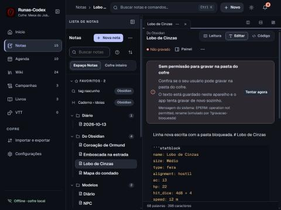
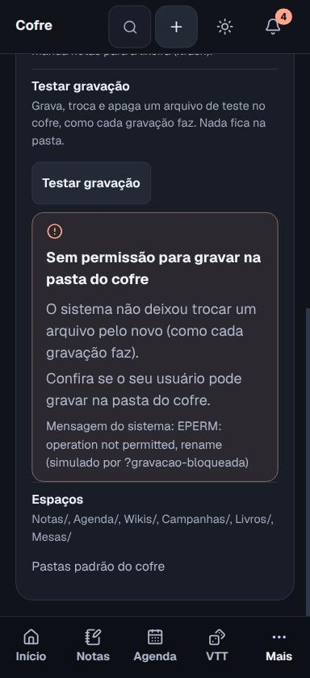

# Gravação bloqueada pela segurança do sistema — U91 itens 1–4 (PR M)

Relato que motivou: no Windows em italiano de um amigo do João, o Microsoft Defender (o mais provável é o Acesso controlado a pastas) impedia o app de gravar; liberar o Runas-Codex no Defender resolveu.

## O que mudou

1. **Nunca perder texto.** Se a gravação de uma nota falha, o texto fica guardado neste aparelho (armazenamento do app, `runas-codex:nao-gravado`, fora do cofre). A nota mostra **“Não gravado”**. O app tenta de novo sozinho em 5 s, 15 s, 30 s e depois a cada minuto, e há o botão “Tentar agora”. Ao gravar, o rascunho some. Ao reabrir a nota (ou o app):
   - se o disco não mudou, o texto volta sozinho e é gravado;
   - se a nota mudou depois (no Obsidian), o app pergunta: “Recuperar o meu texto” ou “Descartar”.

   Fechar o app com texto não gravado pergunta antes. O texto continua guardado de qualquer jeito.
2. **Saber o motivo.** O erro vira um tipo, com título e passo a passo: segurança do sistema, arquivo em uso, disco cheio, somente leitura, sem permissão ou pasta que sumiu.
   - No Windows, `EPERM`/`EACCES` explicam o Acesso controlado a pastas e oferecem “Abrir a proteção do Windows”. O botão abre `windowsdefender://ransomwareprotection`, um endereço local do sistema, sem rede.
   - No Android, o aviso pede a pasta de novo.
3. **Testar antes de precisar.** Em Configurações › Cofre, o botão **“Testar gravação”** faz o mesmo caminho de uma gravação num arquivo de teste oculto: cria, troca e apaga. Ele diz em que passo a pasta recusou e não deixa nada para trás. O mesmo teste roda ao abrir um cofre com gravação liberada; se falhar, um aviso leva às Configurações. No Android ainda não há teste (fica para o PR N).
4. **Gravar com menos cara de ameaça.**
   - No Windows, a troca de arquivo ocupado espera até ~6 s, em vez de ~2 s (o antivírus examinando o arquivo novo).
   - Gravações em lote passam de 20 por segundo só com 40 ms entre elas.
   - O renomear que só troca maiúsculas desfaz o meio do caminho se falhar, em vez de deixar o `.runas-tmp`.

   O nome do temporário continua `.nome.xxxx.runas-tmp`, oculto e com o nome do app.

## Verificação

- Núcleo: `write-failure.test.ts` (cada tipo de erro, Windows/Android/outro, ritmo das tentativas) e `unsaved-drafts.test.ts` (um rascunho por nota, base do disco, recuperar/perguntar/descartar).
- Desktop: `write-check.test.ts` (pasta comum sem resto; pasta `chmod 555` recusa ao criar; troca barrada limpa o que criou), `write-pace.test.ts`, `replace-file.test.ts` (~6 s).
- Smoke: os dois modos registram `writeCheck`. O de gravação exige `ok: true`.
- Navegador, com `?gravacao-bloqueada` (simula `EPERM` na plataforma em memória):
  - ao abrir, o aviso aparece;
  - digitar numa nota mostra “Não gravado” e o passo a passo, e o texto fica no armazenamento;
  - recarregar sem o parâmetro recupera o texto, grava e apaga o rascunho;
  - “Testar gravação” em 320 px diz que a troca foi recusada, sem rolagem lateral e com botão de 44 px.

**Sem verificar** (exige aparelho real):
- Windows com o Acesso controlado a pastas ligado e um antivírus de terceiros;
- o botão “Abrir a proteção do Windows”;
- a pergunta ao fechar no Electron com texto não gravado;
- o aviso “Recuperar o meu texto” com a nota mudada no Obsidian (a regra está nos testes do núcleo).
